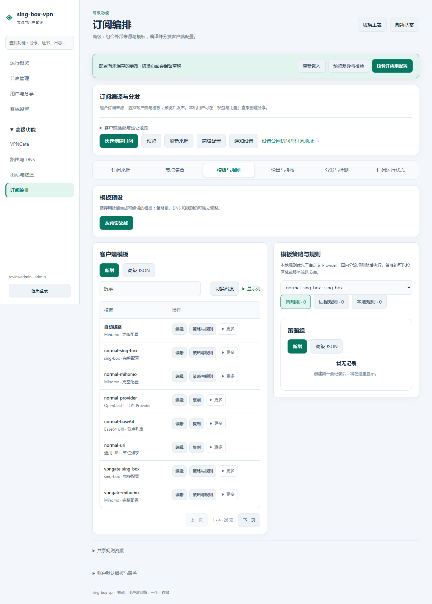

# 导航与日常使用

[使用指南](usage.md) · [公网访问](public-access.md) · [订阅与分享](subscriptions.md)

第一次给别人开通节点：先在「节点管理 → 入站与发布」配置并应用节点，在「系统设置 → 公网访问」设置可分享的 HTTPS 地址，再到「用户与分享 → 权益与用量」新建权益并选择节点，绑定任务完成后点击「创建分享」。配置草稿跨页保留；草稿中的新入站要应用后才能绑定。

管理员的四个常用入口固定显示，点击分组总是打开其第一个可用页面。只有高级区可折叠并记忆；高级页面不再横向重复同一组侧栏入口。手机上先点「打开导航」，选定结果后菜单自动收起。

| 侧栏入口             | 页内标签 / 功能                                                        |
| -------------------- | ---------------------------------------------------------------------- |
| 运行概览             | 常用操作、服务健康、服务控制、近期任务；核心版本与凭据发布在运行详情中 |
| 节点管理             | 入站与发布、证书管理；UDP 跳跃和多端口为可选高级区域                   |
| 用户与分享           | 权益与用量、分享链接；用户分组按需展开                                 |
| 系统设置             | 公网访问、维护与任务、管理员安全                                       |
| 高级功能（默认收起） | VPNGate、路由与 DNS、出站与隧道、订阅编排                              |

新建权益只需关注名称、额度、到期时间和节点范围。有已应用节点时，默认自动绑定；尚无节点时允许先保存权益。绑定失败会保留已创建权益，重试只重新绑定，不重复创建。ID 自动生成，可在高级设置中修改；首次使用激活、预约开始、有效时长和周期重置仍在高级设置中。绑定默认生成凭据，自定义 UUID/密码也在高级设置中。已有权益的周期策略仍不可修改。

普通订阅通过权益行的「分享」创建。在「用户与分享 → 分享链接」查看记录或撤销；多个分享共用同一权益额度。只有组合外部节点、自定义模板或自动分发时，才需要「高级功能 → 订阅编排」。

维护页面使用「任务与日志」「备份与恢复」「程序更新」「网络调优」标签。出站页面使用「代理出站」「WARP / WireGuard」「Argo 隧道」「核心服务」「日志与缓存」标签。可选区域首次打开才创建内容并读取需要的数据；再次切换复用当前页面内容，离页取消读取。

日志查看、占用查看和按需出站探测沿用统一加载弹窗；关闭、替换弹窗或离开页面会取消读取。订阅立即分发默认选择第一个已生效目的地，并要求明确选择；输出检测必须填写探测 URL。保持现有组件、角色权限、窄屏布局和原生 ES 模块规范。

## 找不到功能时

权益列表首次为空时显示创建、绑定、分享的引导。有记录时直接显示搜索、筛选和操作。用「权益范围」切换到归档记录查看历史账期。桌面和触屏都可以展开「更多」，键盘用户可用 Escape 收起菜单。

侧栏搜索包含已收起的高级功能，支持“新增节点”“查流量”“取消分享”，也支持空格分词，如“系统设置 备份”。结果按角色过滤。方向键可在结果间移动，Enter 打开，Esc 关闭。点击页内标签也会更新地址，如 `#outbounds/argo`、`#maintenance/backup`、`#subscriptions/status`；浏览器返回、前进和刷新按地址定位。只在同一工作区切换或返回时，已加载的表单和文件选择才保留；刷新浏览器不会保留文件选择。

管理员可以使用全部入口；操作员可以查看用量、控制服务/VPNGate、查看任务与日志；只读角色只有概览和用量。隐藏菜单不替代服务端权限检查。

## 上游参考

本次对照固定源码，不按项目名称假定其菜单更少：

- [3x-ui 页面登记](https://github.com/MHSanaei/3x-ui/blob/5297fd3c8495d80fab97ae511553fa545c69e913/frontend/src/routes/panelRoutes.tsx)与[侧栏](https://github.com/MHSanaei/3x-ui/blob/5297fd3c8495d80fab97ae511553fa545c69e913/frontend/src/layouts/AppSidebar.tsx)：路由、标题、侧栏和搜索共用登记，页面按需加载；设置和核心配置有子入口。
- [s-ui 前端路由](https://github.com/alireza0/s-ui-frontend/blob/3235da1c7fc07eb7fae13a9bfca7dde147c7e6aa/src/router/index.ts)与[侧栏](https://github.com/alireza0/s-ui-frontend/blob/3235da1c7fc07eb7fae13a9bfca7dde147c7e6aa/src/layouts/default/Drawer.vue)：按入站、用户、出站、端点、证书和系统设置区分资源；移动端使用抽屉。该前端提交为 s-ui `d1c2ce92a77b32388845bc863a7f0a70871f74ca` 引用的子模块版本。

本项目采用清楚的节点/用户/系统职责与统一页面登记，将不常用资源放入高级区；保留原生 ES 模块，不增加生产前端框架或 Node 运行依赖。扩展页面须登记权限、标题、分组、搜索关键词和可选页内定位。

模板与规则页在宽屏上并列显示模板列表和当前模板资源，行内「策略与规则」可直接定位模板；窄屏自动改为单列。资源区域按策略组、远程规则和本地规则切换，共享规则和账户模板覆盖按需展开。

## 多选与多值输入

按使用场景采用三种统一交互：

| 场景 | 交互 | 约束 |
| --- | --- | --- |
| 权益、入口、来源、规则集等已有资源 | 可搜索多选面板，已选摘要、仅看已选、筛选结果全选、分页 | 默认每页 40 个候选；过滤不丢选择；批量权益最多 100 个 |
| 客户端格式和少量协议枚举 | 格式用卡片并按完整配置/节点订阅分组；协议直接展示复选框 | 禁用项说明原因；设备筛选保留已选格式；兼容性重查成功后才允许提交 |
| 域名、CIDR、ASN 等自由输入 | 标签输入，支持逗号/换行粘贴、去重、单项移除和键盘编辑 | 保存读取尚未确认的文本；整数逐项校验，业务规则继续由服务端校验 |

成员顺序具有含义的出站组、策略组和规则集使用同一选择模型，新增成员追加到末尾，提供上移/下移按钮。筛选、分页和卡片分组只改变展示。选择器用原生 checkbox；搜索框按方向下键进入选项，Escape 收起选择面板并回到展开按钮。少量协议的内联复选框不拦截外层弹窗 Escape。长表单底部操作栏保持可见，320px 窄屏也可操作。

参考的是成熟设计系统的交互模式：[Carbon Dropdown](https://carbondesignsystem.com/components/dropdown/usage/) 的过滤多选与摘要、[Ant Design Select](https://ant.design/components/select/) 的搜索/选择上限、[MUI Autocomplete](https://mui.com/material-ui/react-autocomplete/) 的复选框多选与标签输入。本项目用原生模块实现，不增加相应框架、组件库或生产依赖。具体视觉与行为以项目真实浏览器回归为准。
